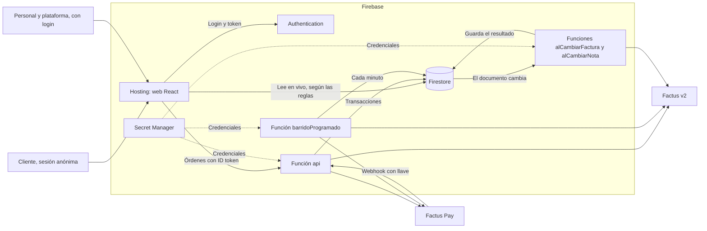
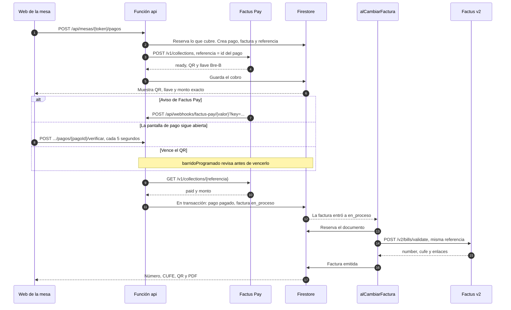

# Arquitectura de Ribu

Cómo está construida la app desplegada en https://ribu-co.web.app. Todo lo que dice este documento sale del código de este repositorio. Lo que se comprobó en producción está en [Explicación de la integración](explicacion-integracion.md).

## Piezas

| Pieza | Carpeta | Qué hace |
|---|---|---|
| Web | `web/` | React y Vite, en Firebase Hosting. Escucha Firestore y le da órdenes a la API |
| API | `flujo/api.ts` | Hono dentro de la función `api`. Autentica, valida y llama a la lógica |
| Lógica | `flujo/` | Pedidos, pagos, facturas, notas, administración y semilla |
| Cobros | `cobros/` | Cliente de Factus Pay y su mock |
| Facturación | `facturacion/` | Cliente de Factus v2 y su mock |
| Contratos | `contratos/` | Tipos, reglas de dinero, estados y la API en OpenAPI |

Hosting envía `/api/**` a la función `api`, en `us-central1`. Cualquier otra ruta sirve `index.html`. Firestore está en `nam5`.

## Colecciones de Firestore

| Documento | Qué guarda |
|---|---|
| `mesas/{token}` | Número, estado y cuenta abierta. El token tiene 128 bits y es la parte fija del link del sticker |
| `restaurantes/{id}` | Nombre, impuesto, propinas sugeridas, vitrina y si está activo |
| `restaurantes/{id}/personal/{uid}` | Cuentas del personal, su rol y si están activas |
| `restaurantes/{id}/productos/{id}` | La carta: precio con impuesto, stock y disponibilidad |
| `restaurantes/{id}/cuentas/{id}` | Líneas del pedido, totales, división y resumen de los pagos |
| `restaurantes/{id}/pagos/{id}` | Qué cubre el pago, su monto congelado, medio, estado y cobro |
| `restaurantes/{id}/facturas/{pagoId}` | Comprador, estado, número, CUFE, enlaces y estado del correo |
| `restaurantes/{id}/notas/{id}` | Notas crédito y débito, su devolución y su cobro |
| `referencias/{id}` | Solo del backend. De qué restaurante es cada recaudo, cuándo vence, cuándo reintentar y quién tiene reservado el documento |

Con emulador o `RIBU_MOCKS=1` también existen `_mocks_cobros` y `_mocks_documentos`, para que los mocks compartan datos entre funciones. En Firestore real no se usan.

## Quién lee y escribe qué

**Nadie escribe desde la web.** `firestore.rules` no tiene ninguna regla de escritura y termina negando todo lo demás. El backend escribe con el SDK de administración, que no pasa por las reglas.

| Documento | Lee | Lista |
|---|---|---|
| `mesas/{token}` | Quien tenga el link. El personal de otro restaurante no | Personal de ese restaurante y plataforma |
| `restaurantes/{id}` | Cualquier sesión | Plataforma |
| `.../personal/{uid}` | Administrador de ese restaurante y plataforma | Los mismos |
| `.../productos/{id}` | Cualquier sesión | Cualquier sesión |
| `.../cuentas/{id}` | Quien tenga el id, que sale de la mesa | Administrador y plataforma todas. Mesero y cocina, abiertas y pagadas |
| `.../pagos/{id}` | Quien tenga el id, que sale de la cuenta | Administrador y plataforma |
| `.../facturas/{pagoId}` | Quien creó el pago, el personal de ese restaurante y la plataforma | Administrador y plataforma |
| `.../notas/{id}` | Administrador y plataforma | Los mismos |
| `referencias/{id}` | Nadie | Nadie |

El comprador solo está en la factura. La cuenta y el pago, que puede leer toda la mesa, no lo llevan.

Quién puede dar cada orden está en `x-roles`, en [`contratos/openapi.yaml`](../contratos/openapi.yaml).

## Seguridad

- **Roles por custom claims.** `rol` y `restauranteId` van en el token de Firebase y los fija el backend. La API los lee del token verificado, nunca del cuerpo ni de la pantalla.
- **Cliente sin registro.** Entra con sesión anónima de Firebase. Sin el claim `rol`, es `cliente`.
- **Quitar el acceso vale de una vez.** Las reglas revisan que el documento de `personal` siga activo y con el mismo rol. La API revisa si el token del personal fue revocado.
- **Un restaurante no ve a otro.** Ni con un link ajeno: las reglas y `exigirRestaurante` lo impiden.
- **La web no manda dinero.** Las órdenes no llevan precios, totales ni estados de pago. El backend los calcula.
- **Secretos en Secret Manager.** Son 7, y la lista está en [Despliegue](despliegue.md). En el reto todos los restaurantes usan las mismas credenciales del sandbox. En producción real, cada NIT necesitaría las suyas: eso no está implementado.
- **Llaves en tiempo constante.** La llave del webhook y la clave de la semilla se comparan por su resumen SHA-256, con `timingSafeEqual`.
- **Errores sin detalles.** La API responde código y mensaje. Los errores internos no salen.
- **Sin caché.** Toda respuesta de la API lleva `Cache-Control: no-store`, para que Hosting no le entregue a otro lo de alguien.

Las reglas tienen 50 pruebas en emulador: `npm run test:reglas`.

## Cloud Functions

Salen de `flujo/funciones.ts`, en `us-central1`.

| Función | Se activa con | Hace | Límite de tiempo |
|---|---|---|---|
| `api` | HTTP, por Hosting | Todas las órdenes, el webhook y la semilla | 60 s |
| `barridoProgramado` | Cada minuto | Revisa cobros vencidos y reintenta documentos y correos. Máximo 30 de cada uno por pasada | 180 s |
| `alCambiarFactura` | Escritura en `facturas/{pagoId}` | Emite cuando la factura entra a `en_proceso` | 180 s |
| `alCambiarNota` | Escritura en `notas/{notaId}` | Emite cuando la nota entra a `en_proceso` | 180 s |

`api` no emite. En Cloud Functions no se puede trabajar después de responder, así que pagar deja la factura en `en_proceso` y el disparador hace el resto.

## Cómo se confirma un pago

El estado `paid` solo vale si se le pregunta a Factus Pay. Un aviso nunca marca nada por sí solo.

Hay tres caminos, y todos terminan en la misma consulta:

1. **Webhook.** `flujo/webhook.ts` valida la llave y consulta el recaudo. La consulta tiene 6 segundos como máximo, para contestar antes de los 10 que exige Factus Pay.
2. **Pantalla abierta.** La web llama a `verificarPago` cada 5 segundos, y en seguida al volver a la pestaña. El backend hace máximo una consulta cada 5 segundos por referencia.
3. **Barrido.** Cuando pasa `venceEn`, pregunta antes de vencer el cobro.

`confirmarPago` exige estado `paid` y monto igual al del pago. Corre en una transacción y repetirlo no cambia nada.

**Webhook y sus respuestas:**

| Situación | Respuesta |
|---|---|
| Llave errada o ausente | 401, sin procesar nada |
| Llave correcta y cuerpo que no se entiende | 400 |
| Referencia desconocida o cobro sin pagar | 200. No hay nada que reintentar |
| Factus Pay no contesta la consulta | 503, para que repita el aviso |
| Pago confirmado | 200 |

El último segmento de la ruta es obligatorio, pero el código no lo lee. Factus Pay tiene una sola URL de webhook, y `referencias/{id}` dice de qué restaurante es el recaudo.

**Pago tardío.** Si llega `paid` de un pago vencido, cancelado o fallido y lo que cubría sigue libre, vale. Si otro pago ya lo cubrió, queda `pago_duplicado`, sin factura, y el personal devuelve el dinero por fuera.

**Límites conocidos.**

- Un pago vencido sale del barrido. Si alguien lo paga después, con la pantalla cerrada y sin webhook, Ribu no se entera.
- El cobro de una nota débito no pasa por el barrido. Se confirma por webhook o con el cobro de esa nota abierto en Facturas, que consulta cada 5 segundos.

## Cómo se emite la factura

`flujo/documentos.ts` emite facturas y notas una sola vez, aunque el aviso se repita o compitan dos procesos:

1. **Reserva.** En una transacción, quien va a llamar a Factus marca `referencias/{id}` por 150 segundos. Con otra reserva vigente, no hace nada.
2. **Emisión.** Llama a Factus con el id del pago como `reference_code`. Con una factura validada, Factus devuelve la misma.
3. **Cierre.** Guarda el resultado y lo refleja en el pago y en la cuenta. Si otro proceso tomó la reserva, su resultado manda.

Si el proceso muere, el barrido retoma el documento cuando pasa la reserva.

## Reintentos

La espera empieza en 60 segundos, se duplica en cada intento y llega hasta 900. Si Factus envía `Retry-After`, se respeta.

| Qué pasa | Estado | Qué hace |
|---|---|---|
| `is_validated` sin rechazo | `en_validacion` | Reintenta con la misma referencia. Nunca elimina |
| 409, 429, 5xx o red | Sigue igual | Reintenta. El cliente no ve un error |
| 401 o 403 | Sigue igual | Con 401 pide otro token y repite una vez. Si sigue, reintenta cada 15 minutos. No es culpa de los datos |
| 422 de Factus | `rechazada` | No hay nada que eliminar. Espera la corrección del personal |
| "Rechazo" en `errors` | `rechazada` | Elimina en seguida, porque bloquea el rango. Si no puede, sigue intentando y no deja reemitir |
| 409 al eliminar | Según la respuesta | El documento ya estaba validado: lo pide una vez y guarda sus datos |
| El disparador no corrió | `en_proceso` | El barrido lo toma a los 120 segundos |

El **correo** nunca afecta la factura. Un fallo de red se intenta hasta 10 veces. Un 422 lo deja `fallido`, con el motivo guardado.

El personal corrige un rechazo desde la pantalla: la factura vuelve a `en_proceso`, con la misma referencia. El rango lo elige `facturacion/` por documento y va explícito en `numbering_range_id`.

## Mocks

`usarMocks` en `flujo/funciones.ts` activa los mocks si corre en el emulador o si `RIBU_MOCKS=1`. En producción no está activo: usa `cobros/cliente.ts` y `facturacion/cliente.ts` contra el sandbox.

La web usa la fuente en memoria solo en desarrollo. La build de producción siempre usa Firebase y no incluye el simulador de la demo.
