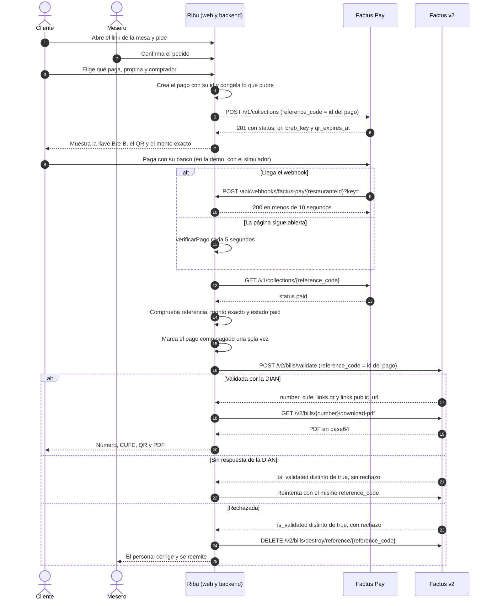
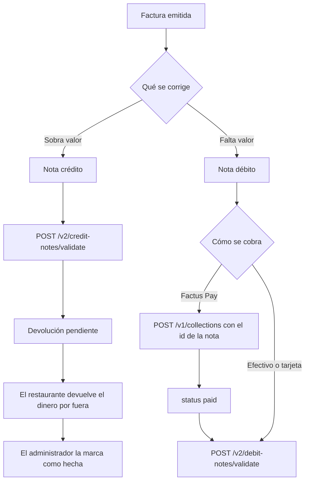

# Explicación de la integración

Entregable del Reto Factus. Explica el problema, la solución, el flujo operativo y el uso técnico de Factus Pay y Factus v2.

**Estado de este documento:** describe el diseño de `contratos/` y la documentación oficial. Todavía no se ha probado contra el sandbox. Lo que falta está en [Por confirmar](#por-confirmar). Antes de entregarlo, hay que actualizarlo con lo que la app haga de verdad.

## 1. El problema

En un restaurante, el pedido, el cobro y la factura suelen ser tres pasos separados. Esto se traduce en tres fricciones:

- **Esperar para pagar:** el cliente depende de que alguien traiga la cuenta y el medio de pago.
- **Relacionar el dinero con la factura:** si el pago entra por un lado y la factura sale por otro, alguien tiene que cruzarlos después.
- **Dividir la cuenta:** cuando cada persona paga lo suyo, el trabajo se multiplica: varios cobros y varias facturas para una sola mesa.

Esta descripción es una hipótesis del equipo, no una medición. Falta contrastarla con restaurantes de Montería: ver `docs/validacion.md`.

## 2. La solución

Ribu conecta el pedido, el cobro y la factura en un solo flujo que parte de la mesa.

Cada mesa tiene un sticker con NFC y QR que abren el mismo link. Desde ahí se pide, el mesero confirma, la cocina prepara y se paga con Factus Pay. Cuando el pago se confirma, el backend emite la factura electrónica con Factus v2, sin que nadie la digite.

Sigue la opción A del reto: primero el recaudo, después la factura.

## 3. Flujo operativo

1. **Pedir.** El cliente abre el link de la mesa y entra sin registrarse. Lo que pide queda `pendiente`. Lo que pide el personal va directo a cocina.
2. **Confirmar.** El mesero confirma o rechaza. Al confirmar, baja el `stock`. Solo lo confirmado se puede pagar.
3. **Preparar.** La cocina avanza cada línea: `en_preparacion`, `lista`, `entregada`.
4. **Elegir qué pagar.** Toda la cuenta, una parte igual o productos específicos. Quien paga elige la propina y el comprador antes de generar el cobro, porque el cobro solo acepta el monto exacto. Por defecto, el comprador es consumidor final.
5. **Pagar.** Ribu crea el recaudo. El cliente copia la llave Bre-B en su banco o escanea el QR desde otro celular.
6. **Confirmar el pago.** Factus Pay avisa por webhook. La página también consulta cada 5 segundos mientras está abierta. En ambos casos, el backend verifica con `GET` antes de marcar el pago.
7. **Facturar.** El backend emite la factura y muestra número, CUFE, QR y PDF. Si el comprador dio un correo, se la envía.
8. **Liberar la mesa.** El mesero la libera cuando no hay pedidos por confirmar, cobros activos ni saldo. El siguiente cliente no ve nada del anterior.

Efectivo y tarjeta no pasan por Factus Pay. Los registra el personal, y también generan factura.

## 4. Diagrama del flujo completo

## 5. Cómo se asocia el dinero con la factura

Este es el centro de la integración. **El id del pago de Ribu es el `reference_code` en Factus Pay y en Factus.** Con ese solo dato se sigue el dinero desde la mesa hasta la DIAN.

| Dónde | Campo | Valor |
|---|---|---|
| Ribu | `Pago.id` | El id del pago |
| Factus Pay | `reference_code` del recaudo | El mismo id |
| Factus v2 | `reference_code` de la factura | El mismo id |
| Ribu | `restaurantes/{id}/facturas/{pagoId}` | El documento de la factura usa el mismo id |

La asociación no se hace después, ni depende de que alguien cruce extractos: existe desde que se crea el pago.

**Qué protege esta decisión:**

- **El webhook se repite.** Puede llegar más de una vez. La factura se emite una sola vez por pago.
- **Se reintenta la factura.** Con una factura ya validada, Factus devuelve la misma aunque se envíe de nuevo, según sus preguntas frecuentes. No se duplica.
- **El pago entra y la factura falla.** Pagar y facturar son estados separados. El pago queda `pagado`, la factura queda `en_proceso` y se reintenta con la misma referencia. El dinero no se pierde de vista.
- **Se paga un QR que ya se había cancelado.** Factus Pay no documenta cómo cancelar un recaudo y no tiene reversos. Si el dinero entra y lo que cubría sigue libre, el pago vale. Si otro pago ya lo cubrió, queda marcado como `pago_duplicado`, sin factura, y el personal devuelve el dinero por fuera.

Cada pago tiene su propio cobro y su propia factura. Una mesa que divide la cuenta en 3 tiene 3 referencias, 3 recaudos y 3 facturas.

Lo que se pide después de un pago va en otro pago, con otra referencia. Un pago congela lo que cubre y su monto.

## 6. Uso técnico de Factus Pay

Entorno: `https://pay-api-sandbox.factus.com.co`. Lo implementa `ServicioCobros`.

| Operación | Uso en Ribu |
|---|---|
| `POST /v1/collections` | Crea el recaudo con `reference_code`, `amount` y `expiration`. Ribu usa 600 segundos. Responde 201 si es nuevo y 200 si ya existía |
| `GET /v1/collections/{reference_code}` | Confirma el estado antes de marcar el pago. Responde 404 si no existe |
| Webhook | Avisa los recaudos `paid`. Es solo un aviso: nunca se factura sin confirmar con `GET` |
| Simulador | Confirma el pago en la demo, porque el reto solo permite el sandbox |

**Autorización:** usar el token sandbox que Integración comparte por privado, en `Authorization: Bearer`. No llamar a `POST /auth`: según `AGENTS.md`, revoca el token del equipo.

**Webhook:** la URL se registra en el panel. Factus Pay envía la llave en `?key=` y el recaudo en `data`. El diseño exige comparar la llave en tiempo constante, guardar el aviso de forma durable y responder 2xx en menos de 10 segundos; la emisión se procesa después. No confirmar recepción si no se guardó. Antes de facturar, consultar y comprobar la referencia existente, el monto exacto y `paid`; recibir un webhook no basta. Los avisos repetidos deben procesarse una sola vez. Si no recibe 2xx, Factus Pay hace hasta 6 intentos en total. Estos controles siguen pendientes de comprobar en el backend desplegado.

**QR vencido:** se renueva con la misma referencia, el mismo monto y otro `expiration`.

**Límites que Ribu respeta:**

- El monto va de $1.000 a $12.100.000, y el cliente debe pagar exactamente ese valor. La llave es de un solo uso y no admite pagos parciales.
- Factus Pay no tiene pagos divididos: dividir la cuenta significa crear varios recaudos.
- Factus Pay no tiene reversos: ver la [sección 9](#9-notas-crédito-y-débito).

## 7. Uso técnico de Factus v2

Entorno: `https://api-sandbox.factus.com.co`. Lo implementa `ServicioFacturacion`. Toda llamada lleva `User-Agent` propio.

| Operación | Uso en Ribu |
|---|---|
| `POST /oauth/token` | Token con datos de formulario. Se renueva con `refresh_token` |
| `GET /v2/numbering-ranges` | Rango activo: documento 21 factura, 22 nota crédito y 23 nota débito |
| `POST /v2/bills/validate` | Emite la factura |
| `DELETE /v2/bills/destroy/reference/{reference_code}` | Elimina una factura rechazada |
| `GET /v2/bills/{number}/download-pdf` | El PDF llega en `pdf_base_64_encoded` |
| `POST /v2/bills/{number}/send-email` | Envía la factura al correo del comprador |

**Cómo se arma la factura:**

| Dato de Ribu | Campo en Factus | Regla |
|---|---|---|
| `Pago.id` | `reference_code` | La asociación con el dinero |
| Precio de carta sin INC | `items[].price` | La carta incluye el INC y Factus pide el precio sin impuesto: lo calcula `baseSinImpuesto` |
| INC del 8 % | `items[].taxes[]` | `code` `04`, `rate` `8.00` |
| Propina | `allowance_charges[]` | `concept_type` `03`, `is_surcharge` `true` |
| Lo que se pagó | `payment_details[]` | Con Factus Pay, `payment_method_code` `47` (transferencia), porque no hay código para Bre-B |
| Consumidor final | `customer` | `identification` `222222222222`. Ver [Por confirmar](#por-confirmar) |

**Ejemplo con los datos de la demo** (`docs/datos-demo.md`):

| Concepto | Valor |
|---|---:|
| 2 mojarras, 2 jugos y 1 patacón, sin INC | 85.000 |
| INC 8 % | 6.800 |
| Consumo que muestra la carta | 91.800 |
| Propina del 10 %, sobre la base sin INC | 8.500 |
| **`amount` del recaudo y total de la factura** | **100.300** |

## 8. Manejo de errores

| Qué pasa | Estado en Ribu | Qué hace |
|---|---|---|
| La DIAN rechaza (`rechazo` en `errors`) | `rechazada` | La elimina en seguida, porque bloquea el rango. El personal corrige y se reemite con la misma referencia |
| La DIAN demora | `en_validacion` | Reintenta con la misma referencia. Nunca la elimina |
| 409 en Factus | `en_proceso` | Hay un documento pendiente bloqueando el rango, y en el sandbox puede ser de otro equipo. Reintenta sin mostrarle un error al cliente |
| 429 o fallo de red | `en_proceso` | Reintenta y respeta `Retry-After` |
| Dos personas cobran lo mismo | Error `PAGO_EN_CURSO` | Una misma unidad no puede estar en dos pagos |
| El QR vence sin pagar | `vencido` | Libera lo que cubría. Si después entra el dinero, aplica la regla de la sección 5 |
| Llave de webhook errada | Error `NO_AUTORIZADO` | No procesa nada |

## 9. Notas crédito y débito

Las crea solo el administrador, y solo sobre una factura `emitida`. No cambian la cuenta de la mesa. Siguen las mismas reglas de rechazo, demora, reintentos, PDF y correo.

**Nota crédito:** anula la factura o rebaja parte de su valor. Factus Pay no tiene reversos, según sus preguntas frecuentes, porque las transferencias van de banco a banco. Por eso el dinero se devuelve por fuera, y la nota queda con la devolución `pendiente` hasta que se registre como `hecha`. Ribu no devuelve el dinero: deja constancia de lo que falta devolver. Una factura no se puede acreditar por más de su valor (`saldoAcreditable`).

**Nota débito:** suma un mayor valor. Con Factus Pay sigue el mismo flujo de la factura: primero el cobro, después la nota. El id de la nota es su `reference_code` en las dos APIs, igual que el id del pago.

| Campo en Factus | Valor |
|---|---|
| `bill_number` | El número de la factura que se corrige |
| `reference_code` | El id de la nota |
| `numbering_range_id` | El rango activo del documento 22 o 23 |
| `correction_concept_code` en crédito | `1` devolución parcial, `2` anulación, `3` rebaja, `4` ajuste de precio |
| `correction_concept_code` en débito | `1` intereses, `2` gastos por cobrar, `3` cambio de valor, `4` otros |
| `customization_id` en los ejemplos oficiales | `20` en crédito y `30` en débito |

## 10. Arquitectura y seguridad

- **Web:** React y Vite, en Firebase Hosting.
- **Backend:** Cloud Functions. Es el único que escribe en Firestore y el único que llama a las dos APIs.
- **Tiempo real:** la web escucha Firestore, así toda la mesa ve los cambios al instante.
- **Identidad:** el cliente entra de forma anónima y el personal con login. El rol sale del token de Firebase, no de la pantalla.
- **Dinero:** la web nunca envía precios, totales ni estados de pago. El backend los calcula.
- **Credenciales:** van en Secret Manager, por restaurante, porque cada NIT tiene las suyas. Nunca en Firestore, en la web ni en el repositorio.
- **Facturas:** solo las leen quien creó el pago y el personal. Lo que ve toda la mesa no lleva datos personales.

## Por confirmar

Salen de `contratos/README.md` y de la lectura de la documentación oficial.

| Tema | Qué falta |
|---|---|
| Factus Pay | El sobre `data`, si `amount` va como número o texto (la documentación dice texto y su ejemplo usa número), el mínimo de `expiration` y el formato de las fechas |
| Estados | Qué estado devuelve Factus Pay con un QR vencido o con un error del simulador. Las páginas leídas solo documentan `ready` y `paid` |
| Webhook | Si el simulador lo dispara |
| Consumidor final | El documento es `222222222222` en las preguntas frecuentes y `22222222222` en el ejemplo oficial |
| INC | Que Factus acepte `04` con `8.00` |
| Redondeo | Que `cash_rounding_amount` cuadre el total. Se prueba con la limonada de `docs/datos-demo.md` |
| Efectivo y tarjeta | Sus códigos de `payment_method_code`. La documentación leída solo confirma `47` para transferencia |
| Notas | La forma de la respuesta y el nombre del código único. Si ya hay rangos activos de documento 22 y 23 |
| Correo | Cómo se envía en el sandbox. `send_email` solo funciona en producción |
| Parte igual | Que un contador acepte facturarla como una sola línea de consumo |
| Impuesto | Que un contador confirme la base de la propina y el INC del restaurante |

## Fuentes

Consultadas el 4 de noviembre de 2026.

- [Documentación de Factus v2](https://developers.factus.com.co) y su [colección](https://developers.factus.com.co/collections/api-factus-v2.json).
- [Preguntas frecuentes de Factus](https://developers.factus.com.co/skills/preguntas-frecuentes-factus.md).
- [Factus Pay: crear un recaudo](https://pay-developers.factus.com.co/recaudos/crear/), [webhooks](https://pay-developers.factus.com.co/webhooks/), [simulador](https://pay-developers.factus.com.co/sandbox/simulator/) y [preguntas frecuentes](https://pay-developers.factus.com.co/preguntas-frecuentes/).
- `contratos/README.md`, `contratos/tipos.ts`, `contratos/reglas.ts` y `contratos/openapi.yaml`.
