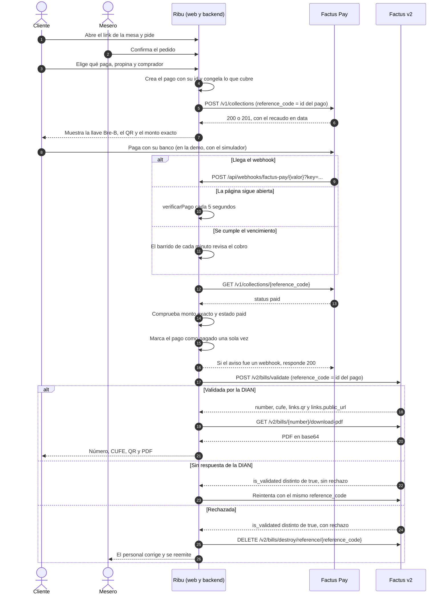
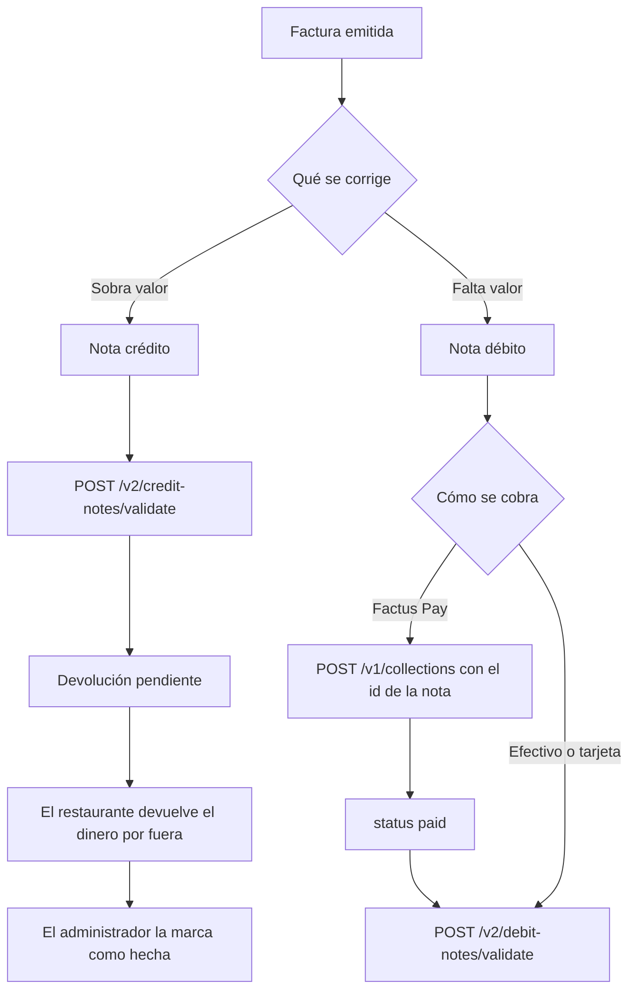

# Explicación de la integración

Entregable del Reto Factus. Explica el problema, la solución, el flujo operativo y el uso técnico de Factus Pay y Factus v2.

**Estado de este documento:** describe lo implementado en este repositorio y lo comprobado con la app desplegada en https://ribu-co.web.app, con las APIs de sandbox, hasta el 4 de noviembre de 2026. El equipo completó pedidos, confirmaciones y pagos en el simulador, y Factus emitió las facturas de esos pagos. Lo que se vio está en [Comprobado en producción](#comprobado-en-producción). Lo que no, en [Por confirmar](#por-confirmar).

Más detalle: [Arquitectura](arquitectura.md), [Manual de uso](manual-de-uso.md) y [Despliegue](despliegue.md).

## 1. El problema

En un restaurante, el pedido, el cobro y la factura suelen ser tres pasos separados. Esto se traduce en tres fricciones:

- **Esperar para pagar:** el cliente depende de que alguien traiga la cuenta y el medio de pago.
- **Relacionar el dinero con la factura:** si el pago entra por un lado y la factura sale por otro, alguien tiene que cruzarlos después.
- **Dividir la cuenta:** cuando cada persona paga lo suyo, el trabajo se multiplica: varios cobros y varias facturas para una sola mesa.

Esta descripción es una hipótesis del equipo, no una medición. Falta contrastarla con restaurantes de Montería: ver `docs/validacion.md`.

## 2. La solución

Ribu conecta el pedido, el cobro y la factura en un solo flujo que parte de la mesa.

Cada mesa tiene un sticker con NFC y QR que abren el mismo link. Desde ahí se pide, el mesero confirma, la cocina prepara y se paga con Factus Pay. Cuando el pago se confirma, el backend emite la factura electrónica con Factus v2, sin que nadie la digite.

Sigue la opción A del reto: primero el recaudo, después la factura.

## 3. Flujo operativo

1. **Pedir.** El cliente abre el link de la mesa y entra sin registrarse. Lo que pide queda `pendiente`. Lo que pide el personal va directo a cocina.
2. **Confirmar.** El mesero confirma o rechaza. Al confirmar, baja el `stock`. Solo lo confirmado se puede pagar.
3. **Preparar.** La cocina avanza cada línea: `en_preparacion`, `lista`, `entregada`.
4. **Elegir qué pagar.** Toda la cuenta, una parte igual o productos específicos. Quien paga elige la propina y el comprador antes de generar el cobro, porque el cobro solo acepta el monto exacto. Por defecto, el comprador es consumidor final.
5. **Pagar.** Ribu crea el recaudo. El cliente copia la llave Bre-B en su banco o escanea el QR desde otro celular. En el sandbox se paga con el [simulador](manual-de-uso.md#pagar-en-el-sandbox), nunca con una app de banco.
6. **Confirmar el pago.** Factus Pay avisa por webhook. La página también consulta cada 5 segundos mientras está abierta, y el barrido de cada minuto pregunta antes de vencer el cobro. En todos los casos, el backend verifica con `GET` antes de marcar el pago.
7. **Facturar.** Un disparador de Firestore emite la factura y la página muestra número, CUFE, QR y PDF. Si el comprador dio un correo, se la envía.
8. **Liberar la mesa.** El mesero la libera cuando no hay pedidos por confirmar, cobros activos ni saldo. El siguiente cliente no ve nada del anterior.

Efectivo y tarjeta no pasan por Factus Pay. Los registra el personal, y también generan factura.

## 4. Diagrama del flujo completo

## 5. Cómo se asocia el dinero con la factura

Este es el centro de la integración. **El id del pago de Ribu es el `reference_code` en Factus Pay y en Factus.** Con ese solo dato se sigue el dinero desde la mesa hasta la DIAN.

| Dónde | Campo | Valor |
|---|---|---|
| Ribu | `Pago.id` | El id del pago |
| Factus Pay | `reference_code` del recaudo | El mismo id |
| Factus v2 | `reference_code` de la factura | El mismo id |
| Ribu | `restaurantes/{id}/facturas/{pagoId}` | El documento de la factura usa el mismo id |

La asociación no se hace después, ni depende de que alguien cruce extractos: existe desde que se crea el pago.

**Qué protege esta decisión:**

- **El webhook se repite.** Puede llegar más de una vez. La factura se emite una sola vez por pago.
- **Se reintenta la factura.** Con una factura ya validada y los mismos datos, Factus devuelve la misma. En el sandbox, un total diferente puede dar 422 porque valida primero el cuadre: el reintento conserva referencia e importes originales.
- **El pago entra y la factura falla.** Pagar y facturar son estados separados. El pago queda `pagado`, la factura queda `en_proceso` y se reintenta con la misma referencia. El dinero no se pierde de vista.
- **Se paga un QR que ya se había cancelado.** Factus Pay no documenta cómo cancelar un recaudo y no tiene reversos. Si el dinero entra y lo que cubría sigue libre, el pago vale. Si otro pago ya lo cubrió, queda marcado como `pago_duplicado`, sin factura, y el personal devuelve el dinero por fuera.

Cada pago tiene su propio cobro y su propia factura. Una mesa que divide la cuenta en 3 tiene 3 referencias, 3 recaudos y 3 facturas.

Lo que se pide después de un pago va en otro pago, con otra referencia. Un pago congela lo que cubre y su monto.

## 6. Uso técnico de Factus Pay

Entorno: `https://pay-api-sandbox.factus.com.co`. Lo implementa `ServicioCobros`.

| Operación | Uso en Ribu |
|---|---|
| `POST /v1/collections` | Crea el recaudo con `reference_code`, `amount` y `expiration`. Ribu usa 600 segundos. En el sandbox responde 200 con `expiration` y 201 sin ella; esos códigos no distinguen nuevo de existente |
| `GET /v1/collections/{reference_code}` | Confirma el estado antes de marcar el pago. Responde 404 si no existe |
| Webhook | Avisa los recaudos `paid`. Es solo un aviso: nunca se factura sin confirmar con `GET` |
| Simulador | Confirma el pago en la demo, porque el reto solo permite el sandbox |

**Autorización:** usar el token sandbox que Integración comparte por privado, en `Authorization: Bearer`. No llamar a `POST /auth`: según `AGENTS.md`, revoca el token del equipo.

**Webhook:** la URL se registra en el panel, con la forma `/api/webhooks/factus-pay/<valor>`. Factus Pay envía la llave en `?key=` y el recaudo en `data`. Así lo implementa `flujo/webhook.ts`:

- Compara la llave en tiempo constante. Con una llave errada responde 401.
- No guarda el aviso. Consulta el recaudo con `GET`, con 6 segundos como máximo, y aplica el resultado en una transacción. Si Factus Pay no contesta, responde 503 para que repita el aviso.
- Exige `paid` y el monto exacto. Una referencia desconocida responde 200 y no hace nada.
- Repetir el aviso no cambia nada. La factura la emite después un disparador de Firestore, fuera de la respuesta.

Si no recibe 2xx, Factus Pay hace hasta 6 intentos en total, según su documentación. La ruta ya respondió 200 y 401 en producción, pero **no se ha visto llegar un aviso real de Factus Pay**. Por eso no se puede decir todavía que ese camino funcione de punta a punta.

**QR vencido:** en el sandbox sigue en `ready`, así que se detecta comparando `qr_expires_at` con la hora actual, no solo por el estado. Se renueva con la misma referencia, el mismo monto y otro `expiration`; regenera el QR y conserva la llave Bre-B. Las fechas llegan como `04-11-2026 12:00:40 PM`, en hora de Colombia, y el backend las convierte a UTC.

**Límites que Ribu respeta:**

- El rango probado es de **$10.000 a $12.000.000**; fuera de él, el sandbox responde 422. Difiere del rango publicado en la documentación. Una cuenta o parte menor de $10.000 se paga en efectivo o con tarjeta. El cliente debe pagar el monto exacto y la llave es de un solo uso, sin pagos parciales.
- Factus Pay no tiene pagos divididos: dividir la cuenta significa crear varios recaudos.
- Factus Pay no tiene reversos: ver la [sección 9](#9-notas-crédito-y-débito).

## 7. Uso técnico de Factus v2

Entorno: `https://api-sandbox.factus.com.co`. Lo implementa `ServicioFacturacion`. Toda llamada lleva `User-Agent` propio.

| Operación | Uso en Ribu |
|---|---|
| `POST /oauth/token` | Token con datos de formulario. Se renueva con `refresh_token` |
| `GET /v2/numbering-ranges` | Rango activo: documento 21 factura, 22 nota crédito y 23 nota débito. La lista llega en `data.data`; hay más de un rango de crédito activo, por lo que se envía `numbering_range_id` explícito |
| `POST /v2/bills/validate` | Emite la factura |
| `DELETE /v2/bills/destroy/reference/{reference_code}` | Elimina una factura rechazada |
| `GET /v2/bills/{number}/download-pdf` | El PDF llega en `pdf_base_64_encoded` |
| `POST /v2/bills/{number}/send-email` | Solicita el envío al correo del comprador. En sandbox, direcciones no autorizadas reciben 422; eso no invalida la factura |

**Cómo se arma la factura:**

| Dato de Ribu | Campo en Factus | Regla |
|---|---|---|
| `Pago.id` | `reference_code` | La asociación con el dinero |
| Precio de carta sin INC | `items[].price` | La carta incluye el INC y Factus pide el precio sin impuesto: lo calcula `baseSinImpuesto` |
| INC del 8 % | `items[].taxes[]` | `code` `04`, `rate` `8.00` |
| Propina | `allowance_charges[]` | `concept_type` `03`, `is_surcharge` `true` |
| Lo que se pagó | `payment_details[]` | Con Factus Pay, `payment_method_code` `47` (transferencia), porque no hay código para Bre-B |
| Consumidor final | `customer` | Probado con documento `13`, `identification` `222222222222`, `names` `Consumidor Final` y organización `2` |

INC `04` con tasa `8.00`, propina y redondeo con `cash_rounding_amount: -0.01` quedaron validados por la DIAN en las pruebas del equipo. Los códigos de medio de pago figuran en las tablas de Factus: efectivo `10`, débito `49`, crédito `48` y transferencia `47`. De estos, se probó `47`; falta probar efectivo y tarjetas en la emisión.

Con `is_validated: true`, `errors` puede contener notificaciones que no bloquean la factura. En facturas es un objeto y en notas un arreglo; no tratar cualquier mensaje como rechazo. El PDF probado llega en `data.file_name` y `data.pdf_base_64_encoded`.

**Ejemplo con los datos de la demo** (`docs/datos-demo.md`):

| Concepto | Valor |
|---|---:|
| 2 mojarras, 2 jugos y 1 patacón, sin INC | 85.000 |
| INC 8 % | 6.800 |
| Consumo que muestra la carta | 91.800 |
| Propina del 10 %, sobre la base sin INC | 8.500 |
| **`amount` del recaudo y total de la factura** | **100.300** |

## 8. Manejo de errores

| Qué pasa | Estado en Ribu | Qué hace |
|---|---|---|
| La DIAN rechaza (`rechazo` en `errors`) | `rechazada` | La elimina en seguida, porque bloquea el rango. El personal corrige y se reemite con la misma referencia |
| La DIAN demora | `en_validacion` | Reintenta con la misma referencia. Nunca la elimina |
| 409 en Factus | `en_proceso` | Hay un documento pendiente bloqueando el rango, y en el sandbox puede ser de otro equipo. Reintenta sin mostrarle un error al cliente |
| 429 o fallo de red | `en_proceso` | Reintenta y respeta `Retry-After` |
| Dos personas cobran lo mismo | Error `PAGO_EN_CURSO` | Una misma unidad no puede estar en dos pagos |
| El QR vence sin pagar | `vencido` en Ribu | Factus Pay puede seguir en `ready`: se compara `qr_expires_at` convertido a UTC. Libera lo que cubría. Si después entra el dinero, aplica la regla de la sección 5 |
| 401 o 403 de Factus | `en_proceso` | Con 401 pide otro token y repite una vez. Si sigue, reintenta cada 15 minutos. No manda al personal a corregir datos que están bien |
| 422 de Factus al emitir | `rechazada` | Factus no lo aceptó, así que no hay nada que eliminar. Espera la corrección del personal |
| 422 al enviar el correo | `correo.estado` en `fallido` | La factura sigue bien. Guarda el motivo |
| Llave de webhook errada | Error `NO_AUTORIZADO`, 401 | No procesa nada |

## 9. Notas crédito y débito

Las crea solo el administrador, y solo sobre una factura `emitida`. No cambian la cuenta de la mesa. Siguen las mismas reglas de rechazo, demora, reintentos, PDF y correo.

El equipo validó anulación, devolución parcial y nota débito en el sandbox. Con los clientes de `main`, directo contra el sandbox, también salieron la nota crédito `CRTE1404` y la nota débito `ND468`. La respuesta incluye `data.number`, `data.cude`, `is_validated`, `errors`, `links.qr`, `links.public_url` y `bill`; el identificador de la nota es **`cude`**. `items.note` no fue obligatorio. Esto comprueba la emisión de notas, no una devolución de dinero. Tampoco es el recorrido por la pantalla del administrador.

**Nota crédito:** anula la factura o rebaja parte de su valor. Factus Pay no tiene reversos, según sus preguntas frecuentes, porque las transferencias van de banco a banco. Por eso el dinero se devuelve por fuera, y la nota queda con la devolución `pendiente` hasta que se registre como `hecha`. Ribu no devuelve el dinero: deja constancia de lo que falta devolver. Una factura no se puede acreditar por más de su valor (`saldoAcreditable`).

**Nota débito:** suma un mayor valor. Con Factus Pay sigue el mismo flujo de la factura: primero el cobro, después la nota. El id de la nota es su `reference_code` en las dos APIs, igual que el id del pago.

| Campo en Factus | Valor |
|---|---|
| `bill_number` | El número de la factura que se corrige |
| `reference_code` | El id de la nota |
| `numbering_range_id` | El rango activo del documento 22 o 23 |
| `correction_concept_code` en crédito | `1` devolución parcial, `2` anulación, `3` rebaja, `4` ajuste de precio |
| `correction_concept_code` en débito | `1` intereses, `2` gastos por cobrar, `3` cambio de valor, `4` otros |

## 10. Arquitectura y seguridad

- **Web:** React y Vite, en Firebase Hosting.
- **Backend:** Cloud Functions: `api`, `barridoProgramado`, `alCambiarFactura` y `alCambiarNota`. Es el único que escribe en Firestore y el único que llama a las dos APIs.
- **Tiempo real:** la web escucha Firestore, así toda la mesa ve los cambios al instante.
- **Identidad:** el cliente entra de forma anónima y el personal con login. El rol sale del token de Firebase, no de la pantalla.
- **Dinero:** la web nunca envía precios, totales ni estados de pago. El backend los calcula.
- **Credenciales:** van en Secret Manager. Nunca en Firestore, en la web ni en el repositorio. En el reto todos los restaurantes usan las mismas credenciales del sandbox. En producción real, cada NIT necesitaría las suyas, y eso no está implementado.
- **Facturas:** solo las leen quien creó el pago, el personal de ese restaurante y la plataforma. Lo que ve toda la mesa no lleva datos personales.

## Comprobado en producción

Todo el 4 de noviembre de 2026, en https://ribu-co.web.app, con las APIs de sandbox y datos inventados.

**Flujo completo en la app desplegada:**

- El equipo hizo pedidos, confirmaciones del mesero y pagos en el simulador.
- Factus Pay marcó los recaudos como `paid`.
- Firestore tiene facturas `emitida` con número y CUFE, por ejemplo `SETP990033517`, en consumidor final y a nombre de persona.
- La factura salió unos 15 segundos después del pago.

**Factus v2, con los clientes de `main` directo contra el sandbox:**

- Factura, a persona y a empresa. Repetir la referencia no duplica.
- PDF, nota crédito `CRTE1404` y nota débito `ND468`.
- `send-email` responde 422, "no autorizado en sandbox". En Firestore, el correo queda `fallido` con ese motivo y la factura sigue bien.

**Factus Pay:**

- Al crear, el recaudo queda `ready`, con QR y llave Bre-B.
- Renovar con la misma referencia y el mismo monto funciona. Con otro monto responde 422.
- Menos de $10.000 responde 422. Una referencia inexistente responde 404.

**Webhook:** registrado en el panel. La ruta responde 200 con la llave correcta y 401 con una errada.

**Pruebas del repositorio:** `npm run verificar` pasa con 938 pruebas. En emulador, con mocks, pasan 50 de reglas de Firestore y 13 del flujo.

**Fotos:** de Wikimedia Commons, con licencias libres, y con sus créditos en `/creditos`. El restaurante es inventado.

## Por confirmar

Lo que sigue sin comprobar, sin maquillar:

| Tema | Qué falta |
|---|---|
| Restaurantes reales | No se ha hablado con ninguno. Ver `docs/validacion.md` |
| Beneficios | Ninguno está medido: ni tiempo ahorrado, ni errores evitados, ni dinero |
| NFC y QR impreso | Sin realizar, según `docs/pruebas-fisicas.md` |
| Webhook | No se ha visto llegar un aviso real de Factus Pay |
| Correo | El sandbox bloquea el envío real. Falta saber qué direcciones autoriza |
| Rechazo real de la DIAN | Sin provocar, para no bloquear el rango compartido. La eliminación inmediata solo está probada con mocks |
| Efectivo y tarjeta | Códigos identificados: efectivo `10`, débito `49` y crédito `48`. Sin registro de una emisión comprobada contra el sandbox |
| Sin impuesto | No se ha probado cómo se envía `ninguno`. La demo usa INC |
| Errores del simulador | Sin observar: `tx_unknown`, `tx_provider_unavailable`, `tx_timeout` y `tx_risk_control` |
| Estado `created` | Aparece en el filtro del panel, pero no se ha observado |
| Parte igual | Falta que un contador acepte facturarla como una sola línea de consumo |
| Base de la propina | Falta que un contador confirme que se calcula sobre la base sin impuesto |

Los recorridos por pantalla y su estado están en `docs/casos-de-prueba.md`.

## Fuentes

Consultadas el 4 de noviembre de 2026.

- [Documentación de Factus v2](https://developers.factus.com.co) y su [colección](https://developers.factus.com.co/collections/api-factus-v2.json).
- [Preguntas frecuentes de Factus](https://developers.factus.com.co/skills/preguntas-frecuentes-factus.md).
- [Factus Pay: crear un recaudo](https://pay-developers.factus.com.co/recaudos/crear/), [webhooks](https://pay-developers.factus.com.co/webhooks/), [simulador](https://pay-developers.factus.com.co/sandbox/simulator/) y [preguntas frecuentes](https://pay-developers.factus.com.co/preguntas-frecuentes/).
- `contratos/README.md`, `contratos/tipos.ts`, `contratos/reglas.ts` y `contratos/openapi.yaml`.
- [Resultados del sandbox documentados por Integración, PR #13](https://github.com/ribu-co/ribu/pull/13), y [revisión de Juan Diego](https://github.com/ribu-co/ribu/pull/2#issuecomment-6637330602).
- `flujo/`, `cobros/`, `facturacion/` y `firestore.rules`, para lo implementado.
